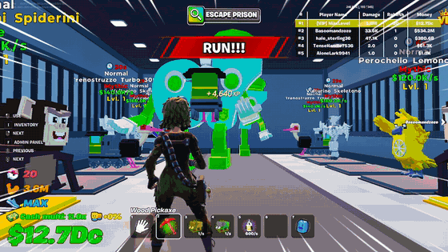
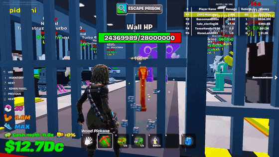

# Escape Prison for Brainrots: launch and fixes

A postmortem of Escape Prison for Brainrots, a tycoon map I built in Fortnite (an online game that lets players build and publish their own games inside it). It has been played for about 36 million minutes, and on June 26, 2026 it had 17,992 players online at the same time.

Island code 9443-3479-4688, released May 15, 2026. I wrote all of the code and every game system for this map myself.

## Launch day

The map was a collaboration with Spider Gamer, one of the biggest Arab Fortnite YouTubers, who was going to play it on a livestream. That set the deadline in stone, because the map had to be live and working when the stream started. In the weeks before, I was working 15+ hours a day to finish the systems in time, and I got most of them done before we agreed to publish.

On the day of the stream, the published version was the previous day's playtest build, which still had bugs. I fixed them that morning and we submitted the new version for Epic's review. Reviews usually take about 30 minutes. This one took around three hours, and when the result came back, with one hour left before the stream, the version had been declined because of a small detail we had missed. One of our in-island purchase offers sold "pickaxes", and Fortnite does not allow that name. We renamed them to "Breakers" and resubmitted straight away, but it was not approved in time, so the stream started on the playtest version. Five minutes in, the fixed version was approved. We pushed it immediately and asked Spider Gamer to restart the game so he was playing the fixed map.

Since then I go through every name and text in a build before I submit it, because one word was enough to hold up the whole launch.

## The first days after launch

Players arrived fast, and the version that went live was still not fully fixed. To keep those players, I fixed the most urgent problems as quickly as I could and barely slept for the first two nights. Over the following weeks, as the player count kept growing, three problems needed deeper fixes. Player data was not always saving, the NPC guards were not following players, and performance dropped under heavy load. The code for each of these fixes is in the last section.

## Balancing the economy

The whole game depends on its economy, and getting it right was one of the hardest parts. I used spreadsheets, Python scripts and simulations, together with data on how players behave (what they buy and how much money they make at each stage of progress), to rebalance it. I changed the starting prices and how much prices rise at each level, the amount needed to rebirth, player income and a number of other values. After the changes, day 1 retention rose from 38.01% on June 22 to 47.89% on June 25, and day 7 retention rose from 10.16% to 15.16% over the same days. Playtime went up as well.

## The first big event

Our first big live event was the Red Moon event on June 26, 2026, when the map reached about 18,000 players online at the same time, its all-time peak. It was my first event of this size, and I spent the whole week before it preparing. On the day itself I was at a wedding and could not fix anything from there, so beforehand I worked through the night to remove every bug I could find. The event went well. A few bugs did come up, and I fixed them as soon as I was back.

## What I would do differently

I did all of the coding and systems work on this map alone, and that is probably the main reason not everything was ready on time. Next time I would hand part of the work to someone on my team, so that the deadline does not depend on one person.

## Technical fixes: code before and after

These fixes went in between late May and July 2026. The "before" code is from my project as it was on May 24, 2026, and the "after" code is from the project in July 2026. Excerpts are shortened and their comments removed.

### 1. Player data not saving properly (spawn_manager.verse)

**Problem.** When a player joined, the game checked for their save only once. If the save had not loaded yet, which can happen when a returning player rejoins quickly, the game treated them as a brand-new player and started them on default data, and the next auto-save overwrote their real progress.

**Before**

```verse
NewAgentData : agent_data = if(SavedStats := GetPlayerSavedStats[Player]):
    GetPersistentData(Player, SavedStats)
else:
    agent_data{Player := Player}
```

**Fix.** The game now keeps checking for the save every half second, for up to 10 seconds (30 seconds at most), before deciding the player is new. If the save turns up late, that session never saves over it, and the player is told to rejoin to get their progress back.

**After**

```verse
ResolveNewPlayerClassification(AgentData : agent_data)<suspends>:void=
    var GraceWaited : float = 0.0
    var GraceWall : float = 0.0
    var RecordAppeared : logic = false
    loop:
        if (PlayerStillInSession[AgentData.Player]):
            if (GetPlayerSavedStats[AgentData.Player]):
                set RecordAppeared = true
                break
            set GraceWaited += 0.5
        if (GraceWaited >= 10.0 or GraceWall >= 30.0):
            break
        set GraceWall += 0.5
        Sleep(0.5)
    if (RecordAppeared?):
        if (PlayerStillInSession[AgentData.Player], A := agent[AgentData.Player]):
            SpawnNotification(A, notification_type.Warning, "Your save could not be loaded - progress this session will NOT be saved. Please rejoin to restore your progress.")
        return
```

### 2. NPC guards not following players (custom_npc_behavior.verse)

**Problem.** Guards that were supposed to chase a player often stopped, stood still or disappeared without following. A guard started moving before the navigation system was ready, so its first move failed. A move request could also hang and never return, which froze the guard in place.

**Before**

```verse
loop:
    if (TargetData := GetAgentData[Target], TargetData.IsNPCImmune?):
        return
    NavTarget := MakeNavigationTarget(Target)
    NavResult := Nav.NavigateTo(NavTarget, ?MovementType := movement_types.Running, ?ReachRadius := 1.0, ?AllowPartialPath := true)
    case (NavResult):
        navigation_result.Reached => Sleep(0.0)
        navigation_result.PartiallyReached => Sleep(0.0)
        navigation_result.Blocked => Sleep(0.25)
        navigation_result.Unreachable => Sleep(0.5)
```

**Fix.** Each guard now waits half a second for the navigation system before it starts chasing. Every move request has a 2-second time limit, so a hung request is cancelled and replaced instead of freezing the guard. A failed path no longer ends the chase, and if a guard keeps failing to find a path, a second part of the code moves it back next to the player.

**After**

```verse
var NavResult : navigation_result = navigation_result.Unreachable
race:
    block:
        set NavResult = Nav.NavigateTo(MakeNavigationTarget(Target), ?MovementType := movement_types.Running, ?ReachRadius := 100.0)
    block:
        Sleep(2.0)
        Nav.StopNavigation()
case (NavResult):
    navigation_result.Blocked =>
        set NavFails += 1
        Sleep(0.25)
    navigation_result.Unreachable =>
        set NavFails += 1
        Sleep(0.25)
    _ =>
        set NavFails = 0
        Sleep(0.05)
```

The guards chasing a player in the current version:



### 3. Performance: health bar rebuilt on every hit (cell_wall_component.verse)

**Problem.** Every pickaxe hit on a cell wall created a new text message and a new material for the wall's health bar, even when the number on screen had not changed. Stronger walls take many hits to lose a single point, so with many players hitting walls at once this was a lot of wasted work on the server.

**Before**

```verse
if (ExistingWidget := PlayerHUDBars[Hitter]):
    set ExistingWidget.ProgressText = CreateMessage("{CurHP}/{MaxHP}")
    set ExistingWidget.ProgressMaterial = ProgressBarWall{Progress := ProgressRatio}
    set ExistingWidget.ProgressFloat = ProgressRatio
```

**Fix.** The wall remembers the last number it showed and only rebuilds the text and material when that number changes. The bar's fill still updates on every hit, because that costs almost nothing.

**After**

```verse
if (ExistingWidget := PlayerHUDBars[Hitter]):
    set ExistingWidget.ProgressFloat = ProgressRatio
    if (CurHP = WallState.LastShownCurHP):
        return
    set WallState.LastShownCurHP = CurHP
    set ExistingWidget.ProgressText = CreateMessage("{CurHP}/{MaxHP}")
    set ExistingWidget.ProgressMaterial = ProgressBarWall{Progress := ProgressRatio}
```

A cell wall's health bar going down as the player hits it:



The complete `spawn_manager.verse` with the save fix is in my [verse-mechanics](https://github.com/artur-piatkevich/verse-mechanics) repository.
